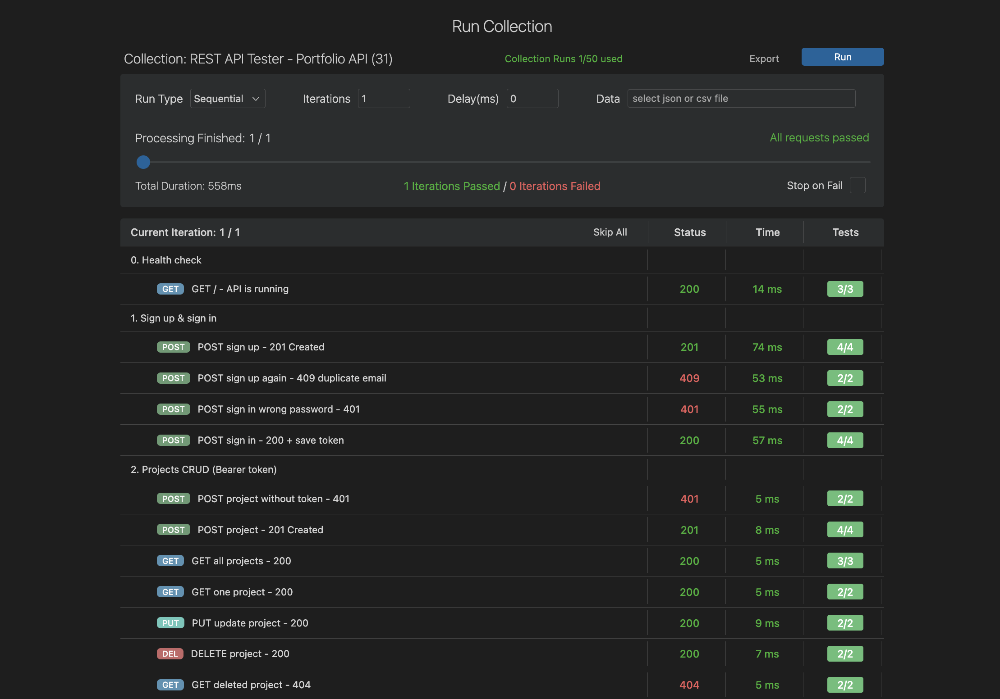
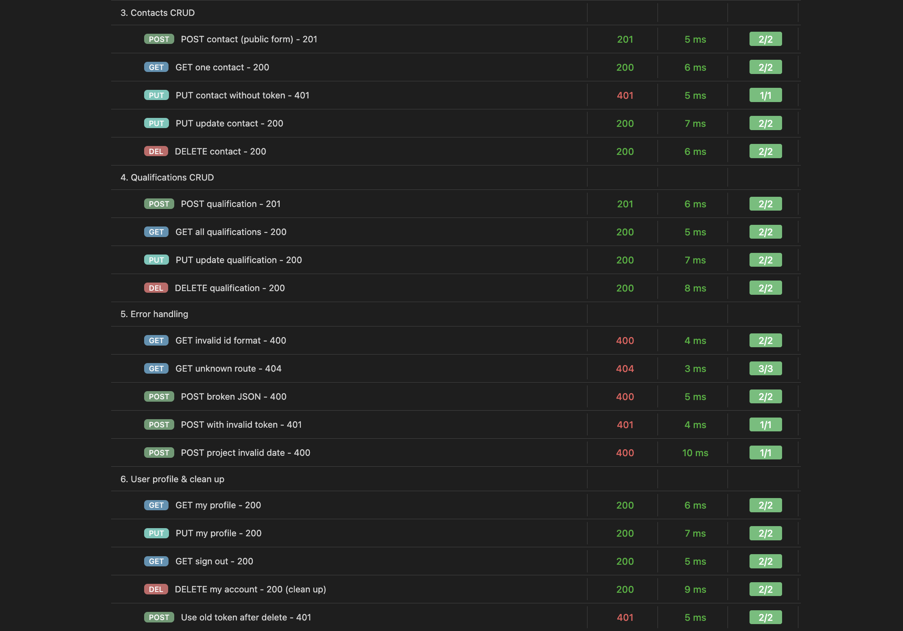
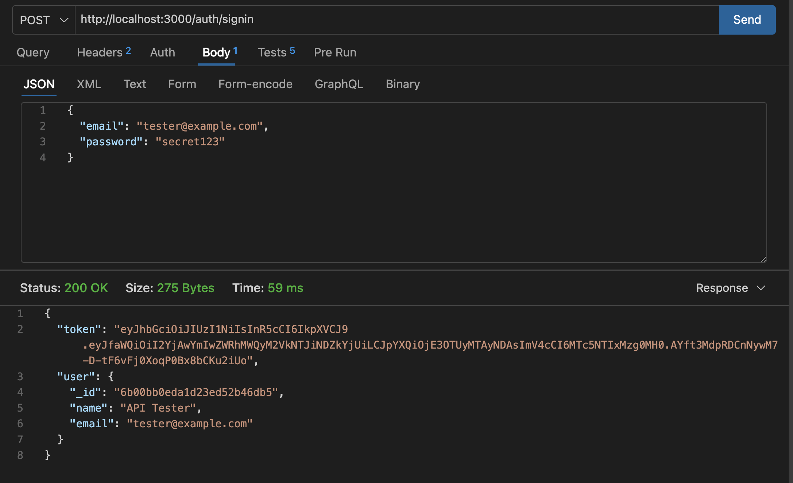
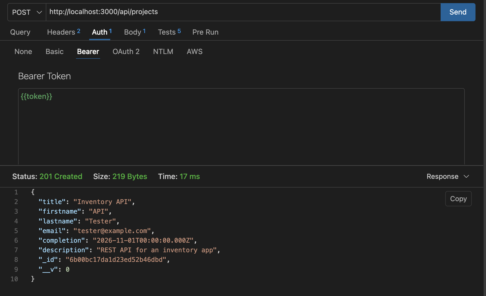
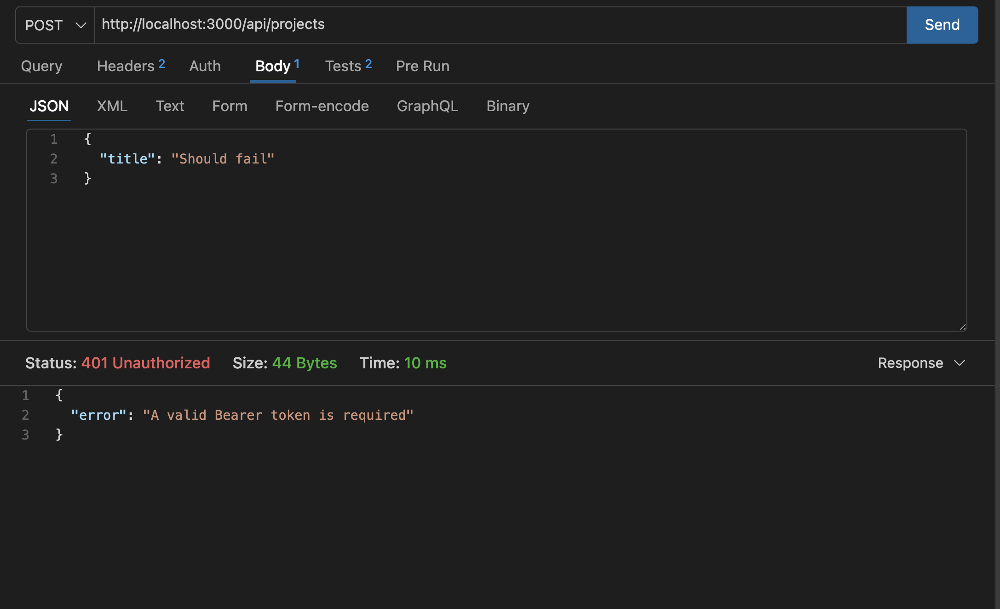
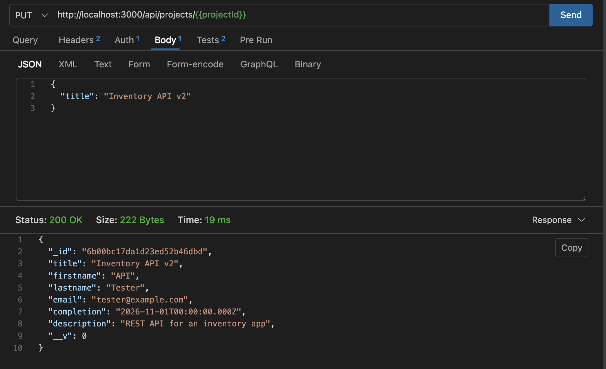
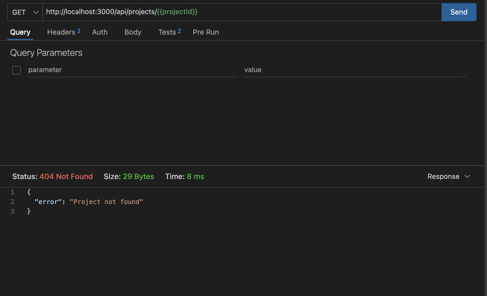
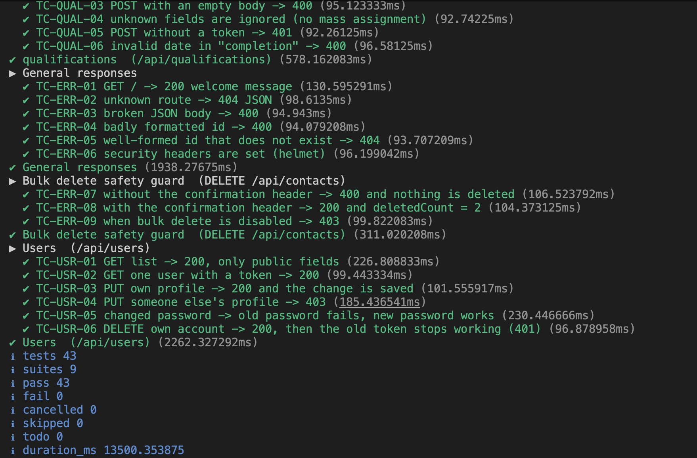

# API Tester — Web Application & REST API Testing

Testing the REST API of a **Node.js / Express** web application connected to **MongoDB**.
I sent **GET, POST, PUT and DELETE** requests to every endpoint, checked the **HTTP status codes** and the **JSON request/response data**, and tested **authenticated requests with Bearer tokens (JWT)**.


---

## What this project shows

| Skill | Where to look |
|---|---|
| CRUD testing with **GET / POST / PUT / DELETE** | [`api-collection/`](api-collection) (31 requests), [`tests/crud.test.js`](tests/crud.test.js) |
| **HTTP status code** validation (200, 201, 400, 401, 403, 404, 409) | [`docs/TEST_CASES.md`](docs/TEST_CASES.md#status-codes-covered) |
| **JSON** request / response validation | assertions in every request of the collection and every test |
| **Bearer token** authentication (sign in → token → protected routes) | [`tests/auth.test.js`](tests/auth.test.js), collection folder *1. Sign up & sign in* |
| Negative testing (no token, expired token, wrong user, bad JSON, bad id) | [`tests/auth.test.js`](tests/auth.test.js), [`tests/errors.test.js`](tests/errors.test.js) |
| Test documentation | [`docs/TEST_CASES.md`](docs/TEST_CASES.md), [`docs/API_REFERENCE.md`](docs/API_REFERENCE.md) |

**Results:** 43 / 43 automated tests passing · 31 requests / 60 assertions passing in the collection run.

---

## How I tested

```
1. Manual testing (Thunder Client)          2. Automated testing (npm test)
   ─────────────────────────────               ──────────────────────────────
   Sign up  → POST /api/users      201         Same scenarios written as code with
   Sign in  → POST /auth/signin    200         Node's built-in test runner + Supertest.
              save {{token}}                   Runs against a temporary in-memory
   Create   → POST   (Bearer)      201         MongoDB, so every run starts clean.
   Read     → GET                  200
   Update   → PUT    (Bearer)      200         3. CI (GitHub Actions)
   Delete   → DELETE (Bearer)      200            ──────────────────────
   Check    → GET deleted id       404            npm test runs on every push.
```

### Example: a Bearer token request

**1) Sign in** — `POST /auth/signin`

```json
{ "email": "tester@example.com", "password": "secret123" }
```

Response `200 OK`

```json
{
  "token": "eyJhbGciOiJIUzI1NiIsInR5cCI6IkpXVCJ9.eyJfaWQiOiI2Yj...",
  "user": { "_id": "6b00a8d1855c30e84a0c1b86", "name": "API Tester", "email": "tester@example.com" }
}
```

**2) Use the token** — `POST /api/projects` with header `Authorization: Bearer <token>`

| Case | Status | Response |
|---|---|---|
| Valid token | `201 Created` | the saved project as JSON |
| No token | `401 Unauthorized` | `{ "error": "A valid Bearer token is required" }` |
| Expired / fake token | `401 Unauthorized` | `{ "error": "A valid Bearer token is required" }` |
| Token of another user (`PUT /api/users/:id`) | `403 Forbidden` | `{ "error": "User is not authorized" }` |

**3) Check the response in Thunder Client** (Tests tab, no scripting needed)

| Type | Path | Action | Value |
|---|---|---|---|
| ResponseCode | | equal | `201` |
| JSON Query | `json.title` | equal | `Inventory API` |
| Set Env Variable | `json._id` | setTo | `{{projectId}}` ← used by the next GET / PUT / DELETE |

---

## Screenshots

**Thunder Client — collection run: 31 requests, all tests passed**

| Folders 0–2 | Folders 3–6 |
|---|---|
|  |  |

| 1. Sign in → JWT token (200) | 2. Create with Bearer token (201) |
|---|---|
|  |  |

| 3. No token → 401 Unauthorized | 4. Update with PUT (200) |
|---|---|
|  |  |

| 5. Deleted item → 404 Not Found | 6. Automated tests: `npm test` (43 passing) |
|---|---|
|  |  |

---

## Run it yourself

Requirements: **Node.js 22+**

```bash
npm install
```

### Option A — Quick start (no database account needed)

Starts the API with a temporary in-memory MongoDB. Data is deleted when you stop it.

```bash
npm run start:memory
```

### Option B — With your own MongoDB (Atlas or local)

```bash
npm run setup      # creates .env with a random JWT secret
# open .env and set MONGODB_URI
npm start
```

The API runs at `http://localhost:3000`.

### Run the automated tests

```bash
npm test
```

### Run the requests in Thunder Client

1. Start the API (Option A or B). It must run on `http://localhost:3000`.
2. VS Code → **Thunder Client** → **Env** tab → **New Environment** → name it `REST API Tester` → **Set Active**.
   (The tests save `{{token}}`, `{{userId}}` and `{{projectId}}` into the active environment, so one must be active.)
3. **Collections** tab → ☰ menu → **Import** → [`api-collection/thunder-collection.json`](api-collection/thunder-collection.json).
4. Run the folders **in order** (0 → 6), or use **Run All** on the collection.
   *Sign in* saves the token to `{{token}}`, and every protected request sends it as a Bearer token.
5. The last folder deletes the test user, so the collection can be run again.

The checks use Thunder Client's built-in (scriptless) tests, so they work in the free version.

### Or in Postman / from the terminal

[`api-collection/postman-collection.json`](api-collection/postman-collection.json) has the same 31 requests with Postman test scripts:

```bash
npx newman run api-collection/postman-collection.json
```

---

## Endpoints

| Resource | Endpoints | Auth |
|---|---|---|
| Auth | `POST /auth/signin`, `GET /auth/signout` | public |
| Users | `GET/POST /api/users`, `GET/PUT/DELETE /api/users/:userId` | sign up public; read needs token; update/delete only your own account |
| Projects | `GET/POST /api/projects`, `GET/PUT/DELETE /api/projects/:projectId` | read public; write needs token |
| Qualifications | `GET/POST /api/qualifications`, `GET/PUT/DELETE /api/qualifications/:qualificationId` | read public; write needs token |
| Contacts | `GET/POST /api/contacts`, `GET/PUT/DELETE /api/contacts/:contactId` | read and create public; update/delete need token |

Full details: [`docs/API_REFERENCE.md`](docs/API_REFERENCE.md)

---

## Project structure

```
rest-api-tester/
├── api-collection/
│   ├── thunder-collection.json                   # 31 requests for Thunder Client
│   └── postman-collection.json                   # same requests for Postman / newman
├── tests/                                        # automated tests (npm test)
│   ├── helpers/testServer.js                     # in-memory MongoDB + sign-in helper
│   ├── auth.test.js                              # sign up, sign in, Bearer token
│   ├── users.test.js                             # profile access rules
│   ├── crud.test.js                              # CRUD for contacts, projects, qualifications
│   └── errors.test.js                            # 400 / 404 / JSON errors, bulk delete guard
├── docs/
│   ├── TEST_CASES.md                             # every test case with expected result
│   ├── API_REFERENCE.md
│   └── screenshots/
├── server/                                       # the API under test
│   ├── routes/        # URL → controller
│   ├── controllers/   # request handling, status codes
│   ├── models/        # Mongoose schemas (User, Project, Qualification, Contact)
│   └── helpers/       # error messages, allowed-field filter, bulk delete guard
├── config/config.js
├── scripts/           # setup (.env) and in-memory start
├── server.js          # connects to MongoDB, starts the server
├── .env.example
└── .github/workflows/tests.yml
```

---

## What I learned

- **Status codes tell a story.** `401` means "who are you?" (missing/invalid token) and `403` means "I know who you are, but you can't do this" (editing another user). Testing both showed me the difference between *authentication* and *authorization*.
- **Test the unhappy path too.** Most bugs hide in negative cases: an expired token, a broken JSON body, an id that looks valid but doesn't exist (`404`) versus an id in the wrong format (`400`).
- **Chain requests with variables.** Saving `token` and `_id` from one response and reusing them in the next request turns single requests into a full CRUD scenario.
- **Never return secrets.** I check that responses never include `hashed_password` or `salt`, and that unknown fields like `isAdmin` are ignored.
- **Automate what you test by hand.** Turning the Thunder Client checks into `npm test` means the whole API is re-checked in seconds on every change.
